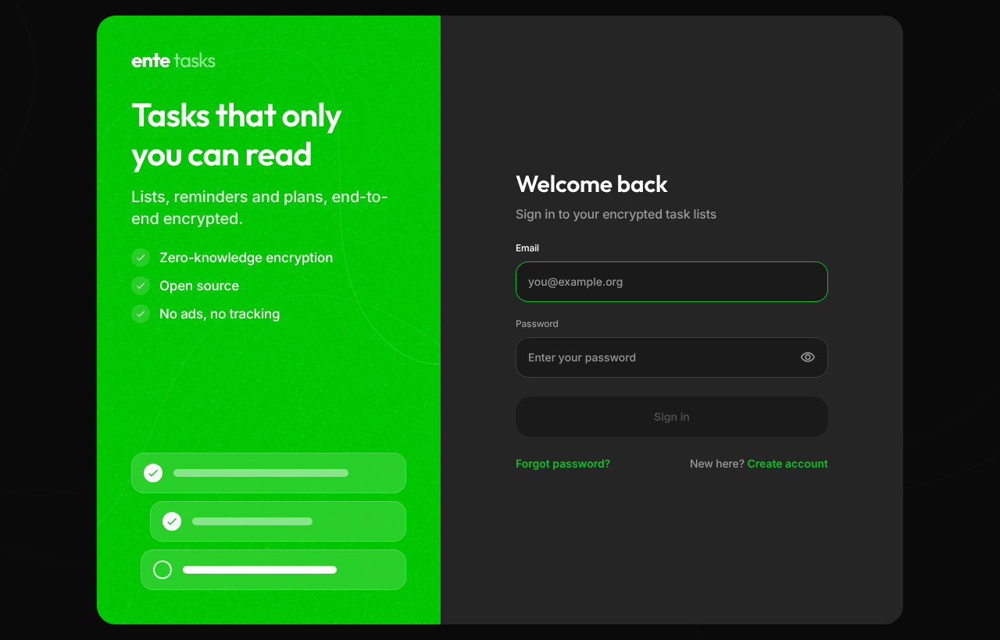
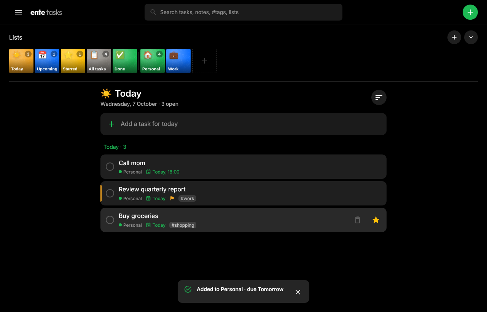
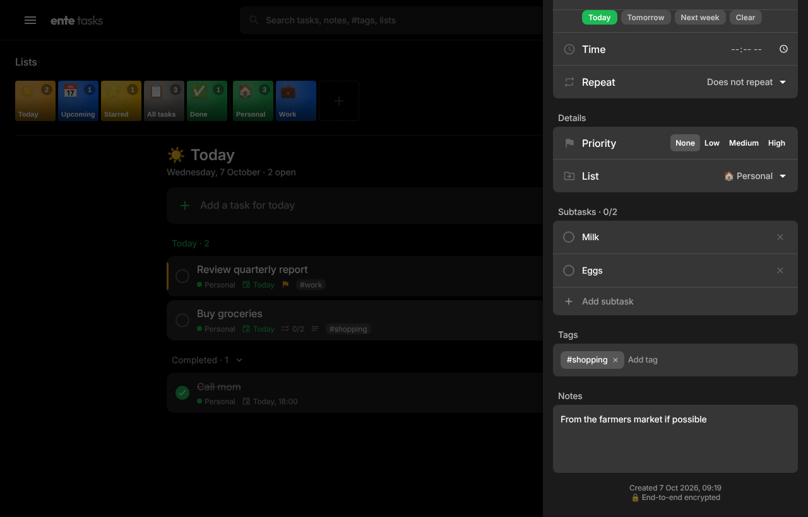
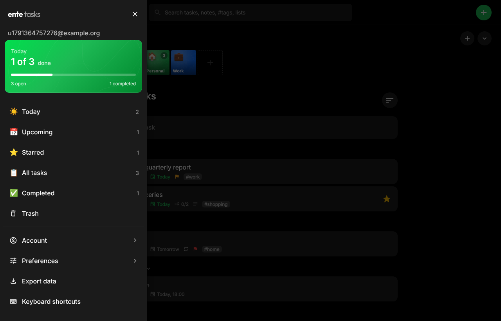

# ente tasks

An end-to-end encrypted to-do app that looks and feels like an [ente](https://github.com/ente/ente) app.

- **Frontend:** React + MUI, using a port of ente's web theme (colours, Inter/Outfit type, buttons, drawers, row buttons, the sign-in page shell and the album bar from ente Photos).
- **Backend:** Python FastAPI + SQLAlchemy.
- **Database:** PostgreSQL.
- **Crypto:** libsodium in the browser, following ente's key scheme.

| | |
|---|---|
|  |  |
|  |  |

## Quick start

```sh
docker compose up --build
```

Then open **http://localhost:8080** and create an account.

To use a different port or set secrets, copy `.env.example` to `.env` and edit it before starting.

## Features

**Tasks**
- Lists with a colour and emoji, shown in an album-style bar like ente Photos
- Smart views: Today (including overdue tasks), Upcoming, Starred, All tasks, Completed
- Quick add with natural language: `Pay rent tomorrow 9am !high #home every month *`
  (dates, weekdays, times, priority `!1`–`!3` or `!high`/`!med`/`!low`, `#tags`, repeat rules, `*` to star)
- Due dates and times, repeating tasks (daily, weekdays, weekly, monthly, yearly), priorities, stars, tags, subtasks and notes
- Grouping by due date (Overdue / Today / Tomorrow / Next 7 days / Later), plus sorting by priority, title or date added
- Search across titles, notes, tags, subtasks and list names (done on the client, since the server only sees ciphertext)
- Trash with restore. Items are deleted permanently after 30 days, as in ente
- Move tasks between lists, duplicate tasks, and export all your data as decrypted JSON
- Keyboard shortcuts: `N` new task, `/` search, `L` new list, `T`/`U`/`A` views, `1`–`9` lists, `?` help
- Light, dark and system themes, and a mobile-friendly layout

**Account and security**
- Zero-knowledge sign-up and sign-in: your password never leaves the browser
- 24-word recovery key, with password reset using that key
- Two-factor authentication (TOTP) with a QR code
- Change password, which signs out your other devices
- List and revoke active sessions
- Delete your account

## How the encryption works

The scheme follows ente's design, using libsodium:

1. **Sign-up.** The browser generates a random 256-bit **master key**. The password is stretched with **Argon2id** (libsodium's moderate limits, run in a web worker) into a **key-encryption key (KEK)**, and the KEK encrypts the master key with XSalsa20-Poly1305. A random **recovery key** also encrypts the master key. It is shown as a 24-word BIP-39 mnemonic.
2. **Authentication.** A **login key** is derived from the KEK with `crypto_kdf` and sent instead of the password. The server stores only an Argon2 hash of it. For unknown emails the server returns fake key-derivation parameters, so it does not reveal which emails have accounts.
3. **Data.** Each list has its own random key, encrypted with the master key. A list's name, colour and emoji, and every task in it (title, notes, dates, tags, subtasks…), are encrypted with that list key before upload. The server stores opaque ciphertext plus a little structural metadata (which list a task belongs to, trash state and timestamps).
4. **Sessions.** As in ente's web app, the auth token stays in `localStorage`, but the decrypted master key is kept only in `sessionStorage`. A new browser session asks for your password to unlock it (the "Unlock" screen).
5. **Recovery.** The recovery key decrypts the master key in the browser. A key derived from it proves possession to the server, and the master key is then re-wrapped under a new password. All existing sessions are signed out.

If you lose both your password and your recovery key, your data cannot be recovered.

## Development

```sh
# Backend (uses SQLite if DATABASE_URL is not set)
cd backend
python -m venv .venv && . .venv/bin/activate
pip install -r requirements.txt pytest httpx
uvicorn app.main:app --reload --port 8000
pytest tests

# Frontend (proxies /api to localhost:8000)
cd web
npm install
npm run dev          # http://localhost:3000
npm run build        # type-check and build
```

The API docs are at `/api/docs`.

## Project layout

```
backend/             FastAPI app
  app/models.py        users, sessions, lists, tasks (all content encrypted)
  app/routers/         auth, account (2FA, sessions, password), data
  tests/
web/                 React app (Vite)
  src/theme/           ente's MUI theme, ported
  src/components/      ente-style building blocks, auth shell, home UI
  src/services/        crypto, API client, encrypted task model
  nginx.conf           serves the SPA and proxies /api in Docker
docker-compose.yml   postgres + api + web
```

## Notes

- This is an independent project inspired by ente's open-source design. It is not affiliated with ente.
- Email verification is not implemented, since no mail server is configured. Sign-up is open to any email address.
- Set a strong `SECRET_KEY` and `POSTGRES_PASSWORD`, and put the app behind HTTPS, before exposing it to the internet.
